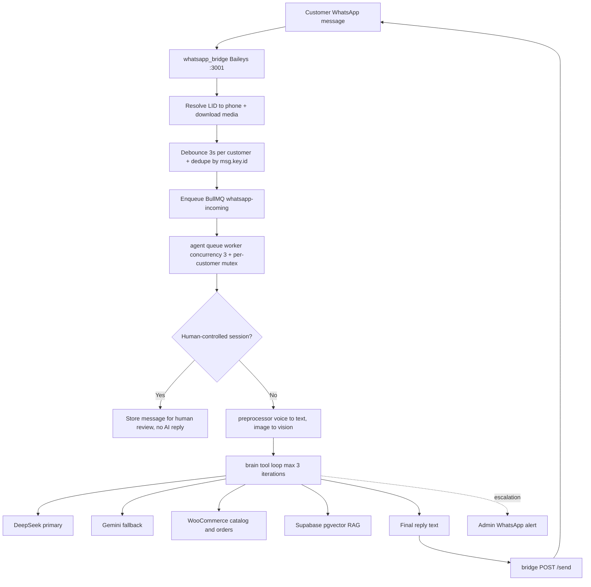
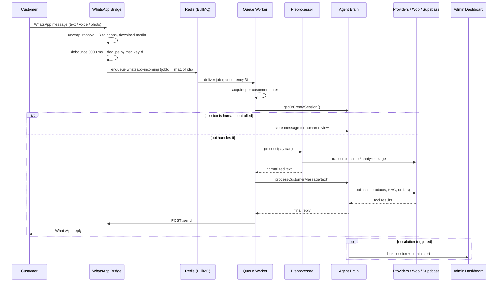
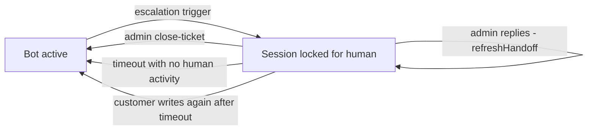
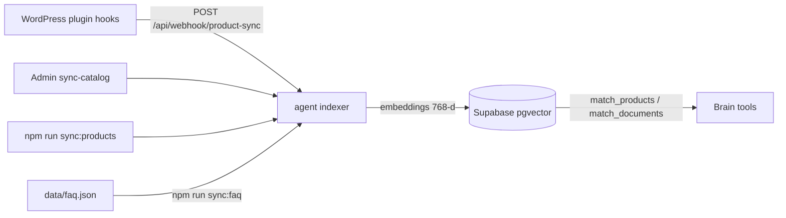

# ARCHITECTURE.md — Hide Haven WhatsApp Support Agent

> System-wide architecture. For the **live-vs-legacy map, deploy procedure, open risks and
> landmines**, read [`AGENT.md`](AGENT.md) first — it is the operational source of truth.
> Per-folder responsibilities live in each folder's `AGENT.md`.

- **Product:** self-hosted WhatsApp customer-support agent for **Hide Haven** (Dhaka, genuine
  leather goods). Answers product/price/delivery/order questions in Bengali / Banglish /
  English, sends product photos, and places **Cash on Delivery** orders in WooCommerce.
- **Status:** live in production, single tenant, single instance, behind a private Cloudflare
  tunnel.

---

## 1. Components at a glance

| Component | Tech | Where it runs | Role | Doc |
|---|---|---|---|---|
| `whatsapp_bridge/` | Node + Baileys | `127.0.0.1:3001` | WhatsApp transport; debounce, dedupe, LID→phone, media download; produces queue jobs. | [`whatsapp_bridge/AGENT.md`](whatsapp_bridge/AGENT.md) |
| **Redis** | Redis 6+ | `127.0.0.1:6379` | BullMQ queue `whatsapp-incoming` **and** the pipeline backbone. Password + AOF. Not managed by PM2. | [`scripts/AGENT.md`](scripts/AGENT.md) |
| `agent/` | TypeScript | `127.0.0.1:3000` | HTTP API + dashboard host + queue worker + brain. | [`agent/AGENT.md`](agent/AGENT.md) |
| `dashboard/` | Static HTML/CSS/JS | served by agent at `/admin` | Admin conversations, escalations, replies, WhatsApp control. | [`dashboard/AGENT.md`](dashboard/AGENT.md) |
| Supabase Postgres | Postgres 17 + pgvector | External | Sessions, messages, catalog, FAQ, orders, settings. | [`agent/src/data/AGENT.md`](agent/src/data/AGENT.md) |
| WooCommerce REST | Woo API v3 | `shop.hidehaven.me` | Catalog + orders (source of truth for price/stock). | [`agent/src/data/AGENT.md`](agent/src/data/AGENT.md) |
| DeepSeek | API | External | **Primary** LLM brain. | [`agent/src/brain/AGENT.md`](agent/src/brain/AGENT.md) |
| Gemini | API | External | **Fallback** brain, transcription, vision, embeddings (FREE tier). | [`agent/src/brain/AGENT.md`](agent/src/brain/AGENT.md) |
| `wordpress-plugin/` | PHP | Store host | Pushes catalog add/change/delete to the agent webhook. | [`wordpress-plugin/AGENT.md`](wordpress-plugin/AGENT.md) |

---

## 2. Deployment topology

Redis is not started by PM2 — bring the whole stack up with
`sh scripts/boot-services.sh` (idempotent). If Redis is down the system *looks* healthy
(WhatsApp stays connected) but answers nobody.

---

## 3. Message pipeline (happy path)

---

## 4. One message, end to end

---

## 5. Human handoff state machine

A session **locks** on escalation (pre-filter regex, the `request_human_escalation` tool, or the
post-filter on the AI reply). It **auto-releases** after `HUMAN_HANDOFF_TIMEOUT_MINUTES` (default
30) of **human inactivity** — the lease is refreshed every time an admin replies.

Locking paths: `brain/agent.ts` (pre-filter / post-filter), `brain/tools.ts`
(`request_human_escalation`), `dashboard` (`lock-ticket`).
Release paths: `index.ts` sweeper, `session/manager.getOrCreateSession`, dashboard
`close-ticket`.

---

## 6. The tool-calling loop

1. Build `contents` from the last ~8 messages.
2. Ask the provider for a turn (`brain/agent.ts`):
   **DeepSeek** (if primary) → **Gemini** (model fallback chain) → DeepSeek fallback.
3. If the turn has **tool calls**: append the turn (provider-neutral via `toSharedModelTurn`),
   execute each tool, append `functionResponse`s, loop (max **3** iterations).
4. If the turn has **text**: that is the reply.
5. If neither: **stop** (do not re-send the identical request).
6. If the loop produced nothing: synthesize with `generateChat` (DeepSeek → Gemini).

Tools (`agent/src/brain/tools.ts`): `search_products`, `send_product_images`,
`search_knowledge_base`, `lookup_order`, `place_order`, `request_human_escalation`.

> **Critical invariant:** `contents` is one array replayed across both providers. Only `text`
> and `functionCall{name,args}` may enter it. DeepSeek-specific fields make Gemini return
> HTTP 400 and poison every fallback. See [`agent/src/brain/AGENT.md`](agent/src/brain/AGENT.md).

---

## 7. Catalog & knowledge ingestion

- **Products:** full sync paginates WooCommerce (20/page, cap 100 pages) with
  `throwOnError:true`; pruning happens **only** after a complete read, so a store outage never
  wipes the catalog.
- **Guards:** thin payloads (no id/name), or those without a valid positive price, are skipped;
  an unknown `stock_status` is stored as `unknown` and treated as **not sellable**.
- **FAQ:** re-seeding is idempotent and replaces the previous set (no stale policy answers).

---

## 8. Data model

| Table | Key columns | Purpose |
|---|---|---|
| `sessions` | `phone` (PK), `is_human_controlled`, `handoff_reason`, `handoff_at`, `metadata` | Per-customer state + handoff lock. |
| `messages` | `phone`, `role` (user/assistant/human/system), `content`, `created_at` | Full transcript. |
| `products` | `id` (PK), `price`, `stock_status`, `images`, `embedding VECTOR(768)` | Catalog mirror for semantic + keyword search. |
| `documents` | `content`, `metadata`, `embedding VECTOR(768)` | FAQ / policy knowledge base. |
| `customer_orders` | order id, `billing->>'phone'`, status | Local order cache for tracking/context. |
| `agent_settings` | `key` (PK), `value` | Runtime settings (e.g. admin alert phone). |

Vector RPCs: `match_documents(vector, 0.55, limit)`, `match_products(vector, 0.50, limit)`.
Queue: BullMQ `whatsapp-incoming`, worker concurrency 3, serialised per customer.

---

## 9. Interfaces

**Agent HTTP (`agent/src/index.ts`)**
`GET /health` (open) · `POST /api/webhook/product-sync` (secret header) ·
`POST /api/admin/login` · `GET /api/admin/conversations` · `GET /api/admin/conversation/:phone` ·
`POST /api/admin/reply` · `POST /api/admin/lock-ticket` / `close-ticket` ·
`POST /api/admin/sync-catalog` · `GET|POST /api/admin/settings` ·
`GET /api/admin/whatsapp/status` · `POST /api/admin/whatsapp/reset` / `toggle-pause` ·
`POST /api/admin/test-alert`. All `/api/admin/*` (except login) require
`Authorization: Bearer <ADMIN_PASSWORD>`.

**Bridge HTTP (`whatsapp_bridge/whatsapp-bridge.js`, loopback, no auth)**
`POST /send` · `POST /send-image` · `GET /qr` · `GET /status` · `POST /pause` · `POST /reset`.

---

## 10. Cross-cutting concerns

| Concern | Design |
|---|---|
| **Reliability** | 3 s debounce, `msg.key.id` dedupe, BullMQ `jobId` idempotency, per-customer mutex, in-memory model cooldowns. |
| **Resilience** | Provider fallback chain; tool errors returned to the model instead of thrown; a Redis `error` listener prevents process crash. |
| **Consistency** | WooCommerce is authoritative for price/stock; the model never invents catalog data. |
| **Security (open)** | Hardcoded secret fallbacks in `config.ts`, dashboard stored XSS, wildcard CORS, 15 MB body before auth, exposed `ttyd` root shell — see root `AGENT.md` § 6. |
| **Scalability** | Deliberately **single-instance**; the per-customer lock is in-process. Latency p50 ≈ 9 s, p90 ≈ 23–37 s. |
| **Observability** | `pino` logs to PM2 stdout, `logs/escalations.jsonl`, `scripts/healthcheck.sh`. |
| **PII** | Phone numbers, addresses, message text and base64 media live in Supabase, escalation log and PM2 logs — treat all of it as sensitive. |

---

## 11. Changing things

| Change | Where | Deploy |
|---|---|---|
| Agent logic | `agent/src/**` | `npx tsc && pm2 restart hh-agent` |
| Bridge logic | `whatsapp_bridge/**` | `pm2 restart whatsapp-bridge` (no build) |
| Dashboard | `dashboard/**` | none (static, served live) |
| FAQ / policy | `data/faq.json` | `cd agent && npm run sync:faq` |
| Catalog | WooCommerce | `npm run sync:products` / admin sync / WP plugin |
| WP plugin | `wordpress-plugin/**` | **upload to the store host** |
| Infra / Redis | `scripts/**` | `sh scripts/boot-services.sh` |

Always finish with `sh scripts/healthcheck.sh`.

---

## Related

[`AGENT.md`](AGENT.md) (operations, risks, landmines) · [`README.md`](README.md) (product
overview) · every folder's `AGENT.md`.
